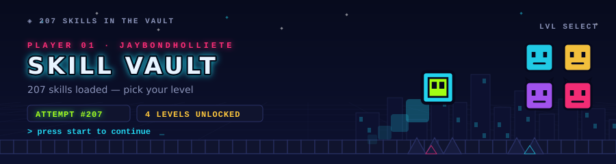
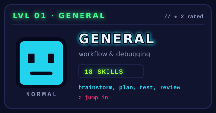
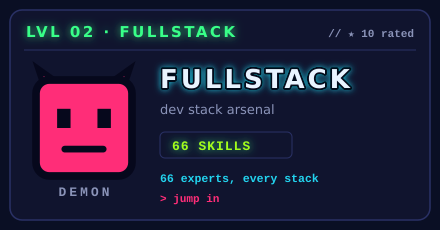
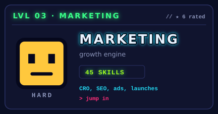
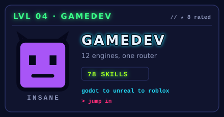

<!-- markdownlint-disable MD033 MD041 -->

<p align="center">
  
</p>

<p align="center">
  
  
  
  
</p>

**207 agent skills in one installable vault — pick your level, your agent does the rest.**

<p align="center">
  
</p>

<h2 align="center">▶ &nbsp;SELECT YOUR LEVEL</h2>
<p align="center"><sub>every skill is a block. every category a level.</sub></p>
<table align="center">
  <tr>
    <td width="50%" align="center"></td>
    <td width="50%" align="center"></td>
  </tr>
  <tr>
    <td width="50%" align="center"></td>
    <td width="50%" align="center"></td>
  </tr>
</table>

<p align="center">
  
</p>

<h2 align="center">◆ &nbsp;LOADOUT</h2>
<p align="center"><sub>install once. jump anywhere.</sub></p>

**One command, any agent.** The [`skills`](https://www.npmjs.com/package/skills) CLI detects the coding agent you use and drops the skills in the right place:

```bash
npx skills add jaybondholliete/skill
```

`--list` to preview, `--skill <name>` to grab single skills, `-a <agent>` to target a specific tool.

**Claude Code plugin (alternative).** This repo is a plugin marketplace with four plugins — one per level:

```bash
claude plugin marketplace add jaybondholliete/skill
claude plugin install general@skill-vault      # workflow & debugging
claude plugin install fullstack@skill-vault    # dev stack arsenal
claude plugin install marketing@skill-vault    # growth engine
claude plugin install gamedev@skill-vault      # 12 engines, one router
```

**Manual.** Copy `skills/<category>/<name>/` into your agent's skills dir (`.claude/skills/`, `.agents/skills/`, `.windsurf/skills/` — whatever it reads). Plain `SKILL.md` files, nothing to convert.

<p align="center">
  
</p>

<h2 align="center">◇ &nbsp;LEVEL INDEX</h2>
<p align="center"><sub>full catalog. no hidden coins.</sub></p>

<!-- CATALOG:BEGIN -->

<details>
<summary><b>GENERAL · workflow & debugging — 18 skills</b></summary>

| skill | what it does |
|---|---|
| `brainstorming` | You MUST use this before any creative work - creating features, building components, adding functionality, or… |
| `dispatching-parallel-agents` | Use when facing 2+ independent tasks that can be worked on without shared state or sequential dependencies |
| `executing-plans` | Use when you have a written implementation plan to execute in a separate session with review checkpoints |
| `find-skills` | Helps users discover and install agent skills when they ask questions like "how do I do X", "find a skill for… |
| `finishing-a-development-branch` | Use when implementation is complete, all tests pass, and you need to decide how to integrate the work -… |
| `headroom` |  |
| `receiving-code-review` | Use when receiving code review feedback, before implementing suggestions, especially if feedback seems… |
| `requesting-code-review` | Use when completing tasks, implementing major features, or before merging to verify work meets requirements |
| `stop-slop` | Remove AI writing patterns from prose. Use when drafting, editing, or reviewing text to eliminate predictable… |
| `subagent-driven-development` | Use when executing implementation plans with independent tasks in the current session |
| `systematic-debugging` | Use when encountering any bug, test failure, or unexpected behavior, before proposing fixes |
| `test-driven-development` | Use when implementing any feature or bugfix, before writing implementation code |
| `unity-mcp-orchestrator` | Orchestrate Unity Editor via MCP (Model Context Protocol) tools and resources. Use when working with Unity… |
| `using-git-worktrees` | Use when starting feature work that needs isolation from current workspace or before executing implementation… |
| `using-superpowers` | Use when starting any conversation - establishes how to find and use skills, requiring skill invocation… |
| `verification-before-completion` | Use when about to claim work is complete, fixed, or passing, before committing or creating PRs - requires… |
| `writing-plans` | Use when you have a spec or requirements for a multi-step task, before touching code |
| `writing-skills` | Use when creating new skills, editing existing skills, or verifying skills work before deployment |

</details>

<details>
<summary><b>FULLSTACK · dev stack arsenal — 66 skills</b></summary>

| skill | what it does |
|---|---|
| `angular-architect` | Generates Angular 17+ standalone components, configures advanced routing with lazy loading and guards,… |
| `api-designer` | Use when designing REST or GraphQL APIs, creating OpenAPI specifications, or planning API architecture.… |
| `architecture-designer` | Use when designing new high-level system architecture, reviewing existing designs, or making architectural… |
| `atlassian-mcp` | Integrates with Atlassian products to manage project tracking and documentation via MCP protocol. Use when… |
| `chaos-engineer` | Designs chaos experiments, creates failure injection frameworks, and facilitates game day exercises for… |
| `cli-developer` | Use when building CLI tools, implementing argument parsing, or adding interactive prompts. Invoke for parsing… |
| `cloud-architect` | Designs cloud architectures, creates migration plans, generates cost optimization recommendations, and… |
| `code-documenter` | Generates, formats, and validates technical documentation — including docstrings, OpenAPI/Swagger specs,… |
| `code-reviewer` | Analyzes code diffs and files to identify bugs, security vulnerabilities (SQL injection, XSS, insecure… |
| `cpp-pro` | Writes, optimizes, and debugs C++ applications using modern C++20/23 features, template metaprogramming, and… |
| `csharp-developer` | Use when building C# applications with .NET 8+, ASP.NET Core APIs, or Blazor web apps. Builds REST APIs using… |
| `database-optimizer` | Optimizes database queries and improves performance across PostgreSQL and MySQL systems. Use when… |
| `debugging-wizard` | Parses error messages, traces execution flow through stack traces, correlates log entries to identify failure… |
| `devops-engineer` | Creates Dockerfiles, configures CI/CD pipelines, writes Kubernetes manifests, and generates Terraform/Pulumi… |
| `django-expert` | Use when building Django web applications or REST APIs with Django REST Framework. Invoke when working with… |
| `dotnet-core-expert` | Use when building .NET 8 applications with minimal APIs, clean architecture, or cloud-native microservices.… |
| `embedded-systems` | Use when developing firmware for microcontrollers, implementing RTOS applications, or optimizing power… |
| `fastapi-expert` | Use when building high-performance async Python APIs with FastAPI and Pydantic V2. Invoke to create REST… |
| `feature-forge` | Conducts structured requirements workshops to produce feature specifications, user stories, EARS-format… |
| `fine-tuning-expert` | Use when fine-tuning LLMs, training custom models, or adapting foundation models for specific tasks. Invoke… |
| `flutter-expert` | Use when building cross-platform applications with Flutter 3+ and Dart. Invoke for widget development,… |
| `fullstack-guardian` | Builds security-focused full-stack web applications by implementing integrated frontend and backend… |
| `game-developer` | Use when building game systems, implementing Unity/Unreal Engine features, or optimizing game performance.… |
| `golang-pro` | Implements concurrent Go patterns using goroutines and channels, designs and builds microservices with gRPC… |
| `graphql-architect` | Use when designing GraphQL schemas, implementing Apollo Federation, or building real-time subscriptions.… |
| `java-architect` | Use when building, configuring, or debugging enterprise Java applications with Spring Boot 3.x,… |
| `javascript-pro` | Writes, debugs, and refactors JavaScript code using modern ES2023+ features, async/await patterns, ESM module… |
| `kotlin-specialist` | Provides idiomatic Kotlin implementation patterns including coroutine concurrency, Flow stream handling,… |
| `kubernetes-specialist` | Use when deploying or managing Kubernetes workloads. Invoke to create deployment manifests, configure pod… |
| `laravel-specialist` | Build and configure Laravel 10+ applications, including creating Eloquent models and relationships,… |
| `legacy-modernizer` | Designs incremental migration strategies, identifies service boundaries, produces dependency maps and… |
| `mcp-developer` | Use when building, debugging, or extending MCP servers or clients that connect AI systems with external tools… |
| `microservices-architect` | Designs distributed system architectures, decomposes monoliths into bounded-context services, recommends… |
| `ml-pipeline` | Designs and implements production-grade ML pipeline infrastructure: configures experiment tracking with… |
| `monitoring-expert` | Configures monitoring systems, implements structured logging pipelines, creates Prometheus/Grafana… |
| `nestjs-expert` | Creates and configures NestJS modules, controllers, services, DTOs, guards, and interceptors for… |
| `nextjs-developer` | Use when building Next.js 14+ applications with App Router, server components, or server actions. Invoke to… |
| `pandas-pro` | Performs pandas DataFrame operations for data analysis, manipulation, and transformation. Use when working… |
| `php-pro` | Use when building PHP applications with modern PHP 8.3+ features, Laravel, or Symfony frameworks. Invokes… |
| `playwright-expert` | Use when writing E2E tests with Playwright, setting up test infrastructure, or debugging flaky browser tests.… |
| `postgres-pro` | Use when optimizing PostgreSQL queries, configuring replication, or implementing advanced database features.… |
| `prompt-engineer` | Writes, refactors, and evaluates prompts for LLMs — generating optimized prompt templates, structured output… |
| `python-pro` | Use when building Python 3.11+ applications requiring type safety, async programming, or robust error… |
| `rag-architect` | Designs and implements production-grade RAG systems by chunking documents, generating embeddings, configuring… |
| `rails-expert` | Rails 7+ specialist that optimizes Active Record queries with includes/eager_load, implements Turbo Frames… |
| `react-expert` | Use when building React 18+ applications in .jsx or .tsx files, Next.js App Router projects, or… |
| `react-native-expert` | Builds, optimizes, and debugs cross-platform mobile applications with React Native and Expo. Implements… |
| `rust-engineer` | Writes, reviews, and debugs idiomatic Rust code with memory safety and zero-cost abstractions. Implements… |
| `salesforce-developer` | Writes and debugs Apex code, builds Lightning Web Components, optimizes SOQL queries, implements triggers,… |
| `secure-code-guardian` | Use when implementing authentication/authorization, securing user input, or preventing OWASP Top 10… |
| `security-reviewer` | Identifies security vulnerabilities, generates structured audit reports with severity ratings, and provides… |
| `shopify-expert` | Builds and debugs Shopify themes (.liquid files, theme.json, sections), develops custom Shopify apps… |
| `spark-engineer` | Use when writing Spark jobs, debugging performance issues, or configuring cluster settings for Apache Spark… |
| `spec-miner` | Reverse-engineering specialist that extracts specifications from existing codebases. Use when working with… |
| `spring-boot-engineer` | Generates Spring Boot 3.x configurations, creates REST controllers, implements Spring Security 6… |
| `sql-pro` | Optimizes SQL queries, designs database schemas, and troubleshoots performance issues. Use when a user asks… |
| `sre-engineer` | Defines service level objectives, creates error budget policies, designs incident response procedures,… |
| `swift-expert` | Builds iOS/macOS/watchOS/tvOS applications, implements SwiftUI views and state management, designs… |
| `terraform-engineer` | Use when implementing infrastructure as code with Terraform across AWS, Azure, or GCP. Invoke for module… |
| `test-master` | Generates test files, creates mocking strategies, analyzes code coverage, designs test architectures, and… |
| `the-fool` | Use when challenging ideas, plans, decisions, or proposals using structured critical reasoning. Invoke to… |
| `typescript-pro` | Implements advanced TypeScript type systems, creates custom type guards, utility types, and branded types,… |
| `vue-expert` | Builds Vue 3 components with Composition API patterns, configures Nuxt 3 SSR/SSG projects, sets up Pinia… |
| `vue-expert-js` | Creates Vue 3 components, builds vanilla JS composables, configures Vite projects, and sets up routing and… |
| `websocket-engineer` | Use when building real-time communication systems with WebSockets or Socket.IO. Invoke for bidirectional… |
| `wordpress-pro` | Develops custom WordPress themes and plugins, creates and registers Gutenberg blocks and block patterns,… |

</details>

<details>
<summary><b>MARKETING · growth engine — 45 skills</b></summary>

| skill | what it does |
|---|---|
| `ab-testing` | When the user wants to plan, design, or implement an A/B test or experiment, or build a growth… |
| `ad-creative` | When the user wants to generate, iterate, or scale ad creative — headlines, descriptions, primary text, or… |
| `ads` | When the user wants help with paid advertising campaigns on Google Ads, Meta (Facebook/Instagram), LinkedIn,… |
| `ai-seo` | When the user wants to optimize content for AI search engines, get cited by LLMs, or appear in AI-generated… |
| `analytics` | When the user wants to set up, improve, or audit analytics tracking and measurement. Also use when the user… |
| `aso` | When the user wants to audit or optimize an App Store or Google Play listing. Also use when the user mentions… |
| `churn-prevention` | When the user wants to reduce churn, build cancellation flows, set up save offers, recover failed payments,… |
| `co-marketing` | When the user wants to find co-marketing partners, plan joint campaigns, or brainstorm partnership… |
| `cold-email` | Write B2B cold emails and follow-up sequences that get replies. Use when the user wants to write cold… |
| `community-marketing` | Build and leverage online communities to drive product growth and brand loyalty. Use when the user wants to… |
| `competitor-profiling` | When the user wants to research, profile, or analyze competitors from their URLs. Also use when the user… |
| `competitors` | When the user wants to create competitor comparison or alternative pages for SEO and sales enablement. Also… |
| `content-strategy` | When the user wants to plan a content strategy, decide what content to create, or figure out what topics to… |
| `copy-editing` | When the user wants to edit, review, or improve existing marketing copy, or refresh outdated content. Also… |
| `copywriting` | When the user wants to write, rewrite, or improve marketing copy for any page — including homepage, landing… |
| `cro` | When the user wants to optimize, improve, or increase conversions on any marketing page or form — including… |
| `customer-research` | When the user wants to conduct, analyze, or synthesize customer research. Use when the user mentions… |
| `directory-submissions` | When the user wants to submit their product to startup, SaaS, AI, agent, MCP, no-code, or review directories… |
| `emails` | When the user wants to create or optimize an email sequence, drip campaign, automated email flow, or… |
| `free-tools` | When the user wants to plan, evaluate, or build a free tool for marketing purposes — lead generation, SEO… |
| `image` | When the user wants to create, generate, edit, or optimize images for marketing — blog heroes, social… |
| `launch` | When the user wants to plan a product launch, feature announcement, or release strategy. Also use when the… |
| `lead-magnets` | When the user wants to create, plan, or optimize a lead magnet for email capture or lead generation. Also use… |
| `marketing-ideas` | When the user needs marketing ideas, inspiration, or strategies for their SaaS or software product. Also use… |
| `marketing-plan` | When the user needs a comprehensive marketing plan for a client, a company they advise, or their own product.… |
| `marketing-psychology` | When the user wants to apply psychological principles, mental models, or behavioral science to marketing.… |
| `offers` | When the user wants to design, construct, or improve an offer — the thing they actually sell — including… |
| `onboarding` | When the user wants to optimize post-signup onboarding, user activation, first-run experience, or… |
| `paywalls` | When the user wants to create or optimize in-app paywalls, upgrade screens, upsell modals, or feature gates.… |
| `popups` | When the user wants to create or optimize popups, modals, overlays, slide-ins, or banners for conversion… |
| `pricing` | When the user wants help with pricing decisions, packaging, or monetization strategy. Also use when the user… |
| `product-marketing` | When the user wants to create or update their product marketing context document. Also use when the user… |
| `programmatic-seo` | When the user wants to create SEO-driven pages at scale using templates and data. Also use when the user… |
| `prospecting` | When the user wants to find, qualify, and build a list of prospects to reach out to — across B2B SaaS,… |
| `public-relations` | When the user wants help with public relations, earned media, press coverage, journalist outreach, or media… |
| `referrals` | When the user wants to create, optimize, or analyze a referral program, affiliate program, or word-of-mouth… |
| `revops` | When the user wants help with revenue operations, lead lifecycle management, or marketing-to-sales handoff… |
| `sales-enablement` | When the user wants to create sales collateral, pitch decks, one-pagers, objection handling docs, or demo… |
| `schema` | When the user wants to add, fix, or optimize schema markup and structured data on their site. Also use when… |
| `seo-audit` | When the user wants to audit, review, or diagnose SEO issues on their site. Also use when the user mentions… |
| `signup` | When the user wants to optimize signup, registration, account creation, or trial activation flows. Also use… |
| `site-architecture` | When the user wants to plan, map, or restructure their website's page hierarchy, navigation, URL structure,… |
| `sms` | When the user wants to plan, build, or optimize SMS or MMS marketing — including welcome flows, abandoned… |
| `social` | When the user wants help creating, scheduling, or optimizing social media content for LinkedIn, Twitter/X,… |
| `video` | When the user wants to create, generate, or produce video content using AI tools or programmatic frameworks.… |

</details>

<details>
<summary><b>GAMEDEV · 12 engines, one router — 78 skills</b></summary>

| skill | what it does |
|---|---|
| `ai-behavior-trees-utility-ai` |  |
| `audio-design` |  |
| `bevy-ecs` |  |
| `camera-systems` |  |
| `card-game` |  |
| `create-game-assets` | Plan, generate, source, normalize, and validate cohesive visual game assets. Use for art direction, style… |
| `defold-core` |  |
| `dialogue-systems` |  |
| `ebitengine-game` |  |
| `fps-shooter` |  |
| `game-ai` |  |
| `game-feel` |  |
| `game-jam` |  |
| `game-ui-ux` |  |
| `godot-2d-movement` |  |
| `godot-3d-essentials` |  |
| `godot-animation` |  |
| `godot-audio` |  |
| `godot-csharp` |  |
| `godot-export` |  |
| `godot-gdscript` |  |
| `godot-gdscript-headless-testing` |  |
| `godot-multiplayer` |  |
| `godot-nodes-scenes` |  |
| `godot-physics` |  |
| `godot-resources` |  |
| `godot-shaders` |  |
| `godot-signals-groups` |  |
| `godot-tilemap` |  |
| `godot-ui-control` |  |
| `input-systems` |  |
| `itch-publish` |  |
| `level-design` |  |
| `love2d-core` |  |
| `performance-optimization` |  |
| `phaser-arcade-physics` |  |
| `phaser-core` |  |
| `physics-tuning` |  |
| `pixijs-rendering` |  |
| `platformer` |  |
| `procedural-gen` |  |
| `prototype-fast` |  |
| `puzzle` |  |
| `pygame-core` |  |
| `roblox-characters` |  |
| `roblox-datastores` |  |
| `roblox-luau` |  |
| `roblox-networking` |  |
| `roblox-physics` |  |
| `roblox-simulator-economy` |  |
| `roblox-studio-workflow` |  |
| `roblox-ui` |  |
| `roguelike` |  |
| `router` |  |
| `rpg` |  |
| `save-systems` |  |
| `shader-programming` |  |
| `steam-publish` |  |
| `survival-crafting` |  |
| `threejs-gltf-loading` |  |
| `threejs-materials-lighting` |  |
| `threejs-scene-setup` |  |
| `tower-defense` |  |
| `unity-animation` |  |
| `unity-build-pipeline` |  |
| `unity-csharp-scripting` |  |
| `unity-input-system` |  |
| `unity-navmesh` |  |
| `unity-physics` |  |
| `unity-scriptableobjects` |  |
| `unity-tilemap-2d` |  |
| `unreal-behavior-trees` |  |
| `unreal-blueprints` |  |
| `unreal-cpp-gameplay` |  |
| `unreal-enhanced-input` |  |
| `unreal-niagara` |  |
| `unreal-packaging` |  |
| `visual-novel` |  |

</details>

<!-- CATALOG:END -->

<p align="center">
  
</p>

<h2 align="center">✦ &nbsp;KIT CONTENTS</h2>

<details>
<summary><b>KIT CONTENTS</b></summary>

- ▣ **207 skills, 4 levels** — `general` (18), `fullstack` (66), `marketing` (45), `gamedev` (78 incl. router)
- ▣ **Agent Skills format** — every skill is a `SKILL.md` with `name` + `description` frontmatter; loads natively in Claude Code, Cursor, Windsurf, Cline, Codex, Gemini CLI, Copilot and more
- ▣ **Claude Code marketplace** — `.claude-plugin/marketplace.json`, generated by `scripts/build-catalog.js`
- ▣ **gamedev extras** — the upstream repo ships intact under `skills/gamedev/`: router, docs, templates, validator scripts
- ▣ **GD skin** — banner/panels generated in `scripts/` from the same palette + primitives as the profile README

</details>

<p align="center">
  
</p>

<h2 align="center">▣ &nbsp;CREDITS</h2>
<p align="center"><sub>all skills © their upstream authors — this vault just keeps the blocks in one place.</sub></p>

The skills are open-source works from [obra/superpowers](https://github.com/obra/superpowers), [Jeffallan/claude-skills](https://github.com/Jeffallan/claude-skills), [coreyhaines31/marketingskills](https://github.com/coreyhaines31/marketingskills), and [gamedev-skills/awesome-gamedev-agent-skills](https://github.com/gamedev-skills/awesome-gamedev-agent-skills) (Apache-2.0). Full per-skill credits and license texts: **[ATTRIBUTION.md](ATTRIBUTION.md)** · [NOTICE.md](NOTICE.md).

<p align="center">
  
</p>

<p align="center">
  
</p>

<p align="center"><sub>PRESS START · 207 skills loaded · skinned for the dash</sub></p>
